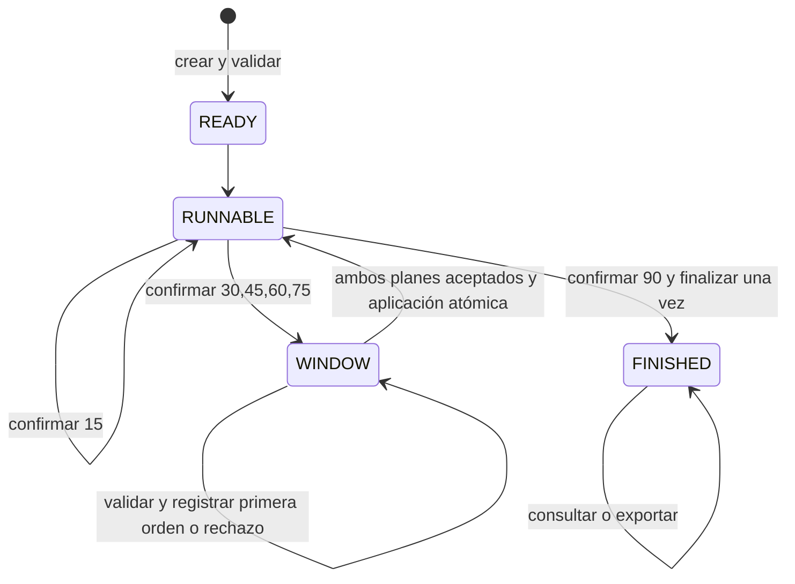

# ADR-0018 — Sesiones de partido incrementales

Fecha: 20/10/2026. Estado: diseño propuesto y prueba aislada de viabilidad; integración productiva pendiente de SIM-004B. Base auditada: `44a05da`. No sustituye ADR-0016/0017 ni modifica versiones vigentes.

Actualización SIM-004B: API de dominio implementada sin conexión a UI/online. Contratos definitivos compilados en `local-match/interactive/types.ts`; ver [QA y decisiones concretas](../qa/SIM-004B.md). El oráculo batch histórico permanece intacto, separado del kernel incremental bajo pruebas de paridad. Los comandos repetidos se rechazan con DUPLICATE_COMMAND y el recibo original se recupera por `receiptFor`; un futuro transporte puede devolverlo como acuse idempotente. Restore exige metadatos SHA-256 de autoridad, separados del snapshot recibido. El registro manual/mixto tiene sobre propio interactive-subs-v1. El boceto original siguiente se conserva como antecedente, no como contrato ejecutable final.

## 1. Sistema observado y dependencias

`simulateMatch` (`local-match/simulator.ts`) es puro respecto de sus entradas, pero hoy ejecuta seis iteraciones completas en una sola llamada. `MATCH_RULES_VERSION` es `local-match-v2`; `actionModel` distingue clásico (ausente), v1, v2 y v3. Estos identificadores no son intercambiables. `MATCH_MINUTES` contiene 15/30/45/60/75/90. El modelo clásico genera una oportunidad por bloque, v1 tres, v2/v3 cuatro. Son marcadores lógicos, no timestamps por segundo.

Orden efectivo de cada bloque:

1. Intentar subs-v1 antes de las oportunidades, en 45/60/75, primero local y después cpu.
2. Acumular mediocampo base; calcular ajustes de ambas tácticas con índice **absoluto** 0–5 y afinidad de formación.
3. Calcular calidad del once actual, bonus comparativo inicial y efectos de técnico recibidos; acumular fuerzas efectivas y calidad.
4. Simular oportunidades: iniciativa, atacante, ruido de remate, remate, al arco, definición y atribuciones condicionales; narrar influencia táctica. Agregar final en 90 y confirmar bloque/marcador.
5. Después de los seis bloques, consumir una tirada principal adicional para posesión y construir promedios, estadísticas y resultado.

`probabilityModel.ts` define v3: iniciativa clamp(0,5 + 0,065×Δglobal + 0,002×clamp(cruce sectorial,−10,10),0,15,0,85); definición clamp(0,30 + 0,018×Δglobal + clamp(ataque−defensa,−15,15)/250 + 0,012×min(3,S+ de campo),0,16,0,52). El resto de la cadena permanece en `simulator.ts`; atribución v3 pondera `(ATT−60)^2` con mínimo 1. No se debe agregar el ruido de definición v2 a v3: cambiaría fórmulas **y** consumo RNG.

| Dependencia | Responsabilidad y condición de extracción |
| --- | --- |
| `seededRandom.ts` | Hash FNV-1a sobre unidades UTF-16 y generador con transición Mulberry32; estado actual cerrado en una closure. La semilla no basta para retomar sin repetir draws. |
| `matchTypes.ts` | Eventos, seis bloques, estadísticas, resumen táctico, calidad y subs; resultado conserva equipos iniciales aunque el once interno cambie. |
| `tacticalModel.ts`, `strategies.ts` | Seis estrategias incl. NEUTRAL, ajustes acotados y fatiga HIGH_PRESS según bloque absoluto; atributos son convenciones del juego, no aptitudes verificadas. |
| `formations`, `eventInfluence`, `squadQuality`, `composeStrength` | Orden de jugadores, asignación posicional, redondeos, narración y bonus influyen en el resultado completo. No reordenar arrays/mapas durante la extracción. |
| `playback.ts`, `MatchScreen.tsx` | Reproducción de un resultado ya calculado: 24 frames en v2/v3, normalmente cada 625 ms; estadísticas visibles provisionales. Los timers son de presentación, no puntos reales de intervención. |
| `matchSeries.ts` | Deriva versión del primer encuentro, semillas `:series:N` y stream independiente `:series:penalties`; restaura plantel inicial y setup. `resolveSeries` calcula toda la serie por adelantado. |
| `auctionEngine.startDuelMatch` | Valida onces y estrategias, fija seed `:match`, recibe efectos de técnico ya calculados. La opción actionModel activa v3/home-away. Con `manualBench` omite benches del simulador: son cambios **previos** al partido, no sustituciones interactivas. |
| `onlineDuel.ts`, `useOnlineSync.ts`, `onlineGateway.ts` | Estado compartido con versión y RPC, pero clientes calculan intents y envían estado; el historial deriva series con `resolveSeries`. Esto no es una autoridad de simulación interactiva suficiente. |

ADR-0016 documenta el antecedente v2; ADR-0017 activa v3 y banco manual previo. PLAYTEST-EXPANSION mide balance, no prueba equivalencia incremental ni seguridad competitiva. Sus presupuestos son históricos; este diseño no los modifica. `roleProfiles` y pie dominante siguen informativos.

## 2. Decisión y máquina de estados

Crear posteriormente un dominio dentro de `local-match/interactive`, independiente de React. Primero extraer un kernel de bloque sin cambiar su orden numérico; adaptador batch histórico y adaptador incremental lo usarán sólo después de acreditar igualdad completa. No pausar una reproducción de un resultado precalculado para simular decisiones: ya habría acontecimientos futuros confirmados.

La primera API incremental admitirá únicamente entradas action-v3 explícitas. Clásico/v1/v2 permanecerán en su ruta histórica; sus golden protegen una eventual extracción compartida, no autorizan convertirlos en sesiones interactivas. Versiones desconocidas se rechazan, nunca se convierten por defecto a v3.



La arista de avance RUNNABLE se interpreta por `nextBlock`: después de 15 sigue 30; después de una ventana sigue el bloque autorizado. Al confirmar 90, finalización y transición FINISHED son atómicas. No hay ventana después de 15 ni 90, ni estado que permita avanzar dentro de WINDOW. El cierre de ventana no consume RNG. `exportResult` antes de FINISHED devuelve `NOT_FINISHED`; consultar nunca avanza.

| Bloque confirmado (índice) | Próximo bloque de aplicación | Ventana |
| --- | --- | --- |
| 30 (1) | 45 (2) | `after-30` |
| 45 (2) | 60 (3) | `after-45` |
| 60 (3) | 75 (4) | `after-60` |
| 75 (4) | 90 (5) | `after-75` |

Una orden validada después de 45 nunca cambia las cuatro oportunidades de 45. En modo automático una sustitución subs-v1 de 45 ya ocurrió al empezar ese bloque, antes de la ventana de 45. Un cambio manual en la ventana de 30 entra al comienzo de 45, antes de computar fuerzas/oportunidades. El cliente puede animar frames del último bloque, pero la ventana se ofrece al completar su presentación; la autoridad ya tiene confirmado ese bloque.

## 3. Contratos TypeScript propuestos (no API productiva)

Los tipos siguientes son boceto para revisión. `Player`, `DraftLineup`, `MatchTeam`, `TeamStrength`, `TacticalFeatures`, `TacticalAdjustment`, `MatchStats`, `MatchBlock`, `MatchResult`, `RosterAdvantage`, `SquadQuality`, `FormationId`, `StrategyId`, `CoachEffect` y `SimulationInput` proceden de los módulos auditados; no se redefinen con fórmulas paralelas. `Pair<T>` usa las claves de dominio `local|cpu`; la identidad de cuenta se mapea en la autoridad, nunca la decide el payload.

```ts
type Side = 'local' | 'cpu';
type Pair<T> = Readonly<Record<Side, T>>;
type BlockIndex = 0 | 1 | 2 | 3 | 4 | 5;
type Phase = 'READY' | 'RUNNABLE' | 'WINDOW' | 'FINISHED';
type BenchMode = 'none' | 'auto-subs-v1' | 'manual-v1';
interface RngState {
  readonly algorithm: 'mulberry32-v1';
  readonly state: number; // uint32; cero válido al reanudar
  readonly draws: number; // entero seguro >= 0, para auditoría
}
interface CurrentSide {
  readonly team: MatchTeam; // once/players actual; metadatos históricos conservados
  readonly strength: TeamStrength;
  readonly features: TacticalFeatures;
  readonly unused: readonly string[]; // conserva orden y descartes subs-v1
  readonly subbed: boolean;
  readonly baseMidfield: number; // suma, nunca promedio parcial redondeado
  readonly departed: readonly string[];
  readonly entered: readonly string[];
  readonly substitutionCount: number;
}
interface Window {
  readonly id: string; // sessionId + bloque confirmado; estable, sin RNG
  readonly applyBlock: 2 | 3 | 4 | 5;
  readonly plans: Pair<Decision | null>;
}
type Order =
  | { readonly type: 'KEEP'; readonly parameters: Record<string, never> }
  | { readonly type: 'STRATEGY'; readonly parameters: { readonly strategy: StrategyId } }
  | { readonly type: 'SUBSTITUTE'; readonly parameters: { readonly outId: string; readonly inId: string } }
  | { readonly type: 'POSTURE'; readonly parameters: { readonly direction: 'ATTACK' | 'DEFEND' } };
interface Decision {
  readonly version: 'interactive-command-v1';
  readonly id: string;
  readonly sessionId: string;
  readonly participant: Side;
  readonly expectedRevision: number;
  readonly windowId: string;
  readonly applyBlock: 2 | 3 | 4 | 5;
  readonly order: Order;
}
type Rejection = 'UNSUPPORTED_VERSION' | 'UNSUPPORTED_ORDER' | 'NOT_MEMBER'
  | 'STALE_STATE' | 'WRONG_WINDOW' | 'WRONG_BLOCK' | 'ALREADY_SUBMITTED'
  | 'ID_CONFLICT' | 'INVALID_PAYLOAD' | 'INVALID_STRATEGY' | 'INVALID_SUBSTITUTION'
  | 'INVALID_ROSTER' | 'BUDGET_EXCEEDED' | 'NOT_FINISHED' | 'INVALID_PHASE';
type Receipt = { readonly id: string; readonly payloadDigest: string; readonly revision: number }
  & ({ readonly status: 'ACCEPTED'; readonly decision: Decision }
    | { readonly status: 'REJECTED'; readonly reason: Rejection });
interface InteractiveResult {
  readonly version: 'interactive-result-v1';
  readonly kernelVersion: 'action-v3-incremental-v1';
  readonly inputDigest: string;
  readonly decisions: readonly Decision[]; // aceptadas y aplicadas, orden canónico
  readonly result: MatchResult; // tactics.selection indica selección inicial;
  // los cambios durante el partido se describen en decisions, no se pierden
}
interface Snapshot {
  readonly schemaVersion: 'interactive-session-v1';
  readonly kernelVersion: 'action-v3-incremental-v1';
  readonly sessionId: string;
  readonly revision: number;
  readonly phase: Phase;
  readonly source: SimulationInput; // JSON completo y congelado, no referencia al catálogo vivo
  readonly inputDigest: string; // serialización canónica con orden de arrays conservado
  readonly benchMode: Pair<BenchMode>;
  readonly ownership: Pair<readonly string[]>;
  readonly acquisition: Pair<{ readonly spent: number; readonly coachPaid: number; readonly budget: number }>;
  readonly nextBlock: 0 | 1 | 2 | 3 | 4 | 5 | 6;
  readonly rng: { readonly main: RngState; readonly substitutions: RngState | null };
  readonly initialTeams: Pair<MatchTeam>;
  readonly initialStrengths: Pair<TeamStrength>;
  readonly initialQuality: Pair<SquadQuality>;
  readonly rosterAdvantage: RosterAdvantage | null;
  readonly current: Pair<CurrentSide>;
  readonly selection: Pair<StrategyId>;
  readonly coachEffects: Pair<(CoachEffect & { readonly id: string }) | null>;
  readonly adjustmentTotals: Pair<TacticalAdjustment>;
  readonly effectiveTotals: Pair<TacticalAdjustment>;
  readonly qualityTotals: Pair<number>;
  readonly stats: Pair<MatchStats>;
  readonly score: Pair<number>;
  readonly blocks: readonly MatchBlock[];
  readonly substitutions: readonly { readonly minute: 15 | 30 | 45 | 60 | 75 | 90;
    readonly side: Side; readonly outPlayerId: string; readonly inPlayerId: string }[];
  readonly window: Window | null;
  readonly receipts: readonly Receipt[];
  readonly appliedDecisions: readonly string[];
  readonly finalized: boolean; // protege la única tirada final de posesión
  readonly result: InteractiveResult | null;
}
// Boceto de funciones puras. Outcome contiene snapshot + recibo/error tipado.
// createSession(input, trustedAcquisition, benchMode, sessionId): Outcome
// inspect(snapshot): PublicProjection (sin futuros ni RNG/seed privados online)
// advanceBlock(snapshot): Outcome
// submitDecision(snapshot, authenticatedSide, command): Outcome
// applyWindow(snapshot): Outcome  // exige los dos planes; orden canónico local/cpu
// finish(snapshot): Outcome      // sólo seis bloques, no RNG si ya finalized
// exportResult(snapshot): ResultOutcome
// restore(json: unknown, supportedVersions): RestoreOutcome
```

SIM-004B debe concretar y compilar estos contratos, separando `MatchResult` histórico del sobre `InteractiveResult`. La igualdad sin intervenciones se aplica a su campo `result`; el sobre conserva trazabilidad adicional. El resumen táctico mantiene selección inicial y medias realmente acumuladas; la secuencia de cambios se reconstruye del registro, no de una supuesta táctica única final. No añadir campos interactivos obligatorios a los resultados guardados. El prototipo de esta fase sólo implementa `RngState`, no estas operaciones. Snapshot es la representación privada de reanudación; PublicProjection contiene únicamente bloques confirmados, marcador/estadísticas parciales y disponibilidad, sin closures, Map/Set, Date, undefined requerido, NaN ni Infinity. Los tiempos de red son metadatos de autoridad fuera de la función pura.

## 4. RNG, serialización y compatibilidad numérica

Persistir dos estados uint32, contador y algoritmo. Inicializar principal con `hashSeed(seed)||1`, sustituciones con `hashSeed(seed + ':subs')||1` cuando corresponde históricamente; restaurar **sin** volver a aplicar `||1`. Cada extracción suma `0x6D2B79F5` con aritmética de 32 bits, reproduce `Math.imul`/shifts existentes y devuelve valor y próximo estado, sin mutar el anterior. No generar seed nueva al restaurar. No usar `Math.random`, temporizadores ni IDs aleatorios dentro del dominio.

No se puede derivar un cursor como cuatro oportunidades × N draws: disparos, goles y atribuciones consumen cantidades distintas. V3 además evita el draw de ruido de definición que v1/v2 sí consumen. El stream de sustituciones es compartido entre ambos equipos, en orden local/cpu; separarlo ahora por equipo rompería subs-v1. Si no quedan suplentes no hay tirada de probabilidad. Si se elige un suplente y no hay titular elegible, el código histórico ya lo retiró de `unused` antes de abortar: preservar también este caso y sus draws en el adaptador histórico.

Acumuladores guardados en precisión completa; sólo redondear al construir las salidas donde hoy se redondea. `meanAdjustment` divide por seis, no por bloques jugados. Bonus comparativo se calcula sobre fuerzas iniciales, mientras calidad se recalcula por bloque; no recalcular retroactivamente la ventaja al sustituir. Conservar `baseMidfield`, `subbed` y los equipos iniciales para producir la misma posesión/resultados. La posesión final se calcula una sola vez tras 90; la provisional de `visibleStats` es otra métrica y debe seguir etiquetada como tal.

Snapshot debe pasar validación estricta de versión, forma, límites, integridad de inputs, alineaciones, contadores y estado de fase; hash no equivale a autenticación. Una sesión online sólo se restaura desde almacenamiento de autoridad. Catálogo completo seleccionado e inputs inmutables (o archivo inmutable direccionado por digest) evitan que una actualización editorial altere una reanudación. Conservar orden de arrays; canonicalizar únicamente claves de objetos al calcular digest. No serializar funciones de `strengthFor`, generadores ni callbacks; reconstruir cálculos a partir de datos.

## 5. Decisiones, validación y efectos

Una instrucción por equipo y ventana en primera implementación: KEEP, cambio de estrategia o una sustitución. No combinar acciones ni cambiar formación en esta fase de diseño. Ambos envían explícitamente KEEP si no quieren cambiar; no existe KEEP implícito debido al orden de llegada. Una instrucción aceptada es inmutable y queda pendiente hasta cierre conjunto. Aplicar en forma atómica y canónica antes de la siguiente evaluación de fuerzas; no RNG durante validación/aplicación. Los rechazos quedan auditados sin modificar bloques, marcador, estadísticas ni RNG.

Validar: contrato/versión y campos exactos, identidad autenticada y pertenencia, ID y digest, fase/ventana, revisión esperada, bloque futuro correcto, lado pendiente, tipo/parámetros; luego elegibilidad táctica o sustitución. Reintento con mismo ID y mismo payload devuelve el recibo original antes del chequeo de revisión obsoleta; mismo ID con otro payload da ID_CONFLICT. ID nuevo para una ventana ya contestada da ALREADY_SUBMITTED. Identidad fraudulenta se registra en auditoría de seguridad sin devolver planes privados del rival. Un rechazo persistido puede avanzar revisión de auditoría, pero jamás progreso deportivo.

Estrategia: identificador existente, pareja de tácticas aplicada al siguiente bloque con índice absoluto. No reiniciar desgaste de HIGH_PRESS al elegirla tarde. Actualmente los efectos de técnico llegan precomputados por `coachEffect` al empezar; las afinidades pueden depender de táctica. Propuesta inicial: congelar esos efectos durante el partido, documentándolo en el nuevo modo; recalcularlos sería otra regla/versionado y calibración. No prometer bonus interactivos definitivos. POSTURE prepara el contrato pero responde UNSUPPORTED_ORDER hasta justificar y aprobar fórmula, límites y calibración. No simularla como KEEP aceptado.

Cada decisión aplicada añade ID al registro; replay reproduce inputs + secuencia aceptada en ventanas, no la hora de llegada ni intentos rechazados. Guardar hashes previo/posterior y bloque de aplicación para diagnóstico; la autoridad calcula esos campos. Un prefijo de bloques confirmado es inmutable incluso ante comandos erróneos o reconexión.

## 6. Sustituciones y economía

`isValidBench` actual valida hasta tres IDs conocidos, únicos y fuera del propio once; por sí solo no comprueba exclusividad entre equipos ni presupuesto combinado, y permite ARQ aunque subs-v1 no los introduce. No endurecer esa validación retroactivamente en el simulador histórico. Crear validación nueva en la frontera interactiva y exigir roster/ledger autorizado: once, banco y técnico ya adquiridos, propiedad exclusiva por ID y por identidad editorial resuelta, once válido según formación, hasta tres reservas/cambios, sin compras durante partido. Precio de adjudicación real no puede inferirse del precio base; el gasto autorizado viene de la subasta.

Manual-v1 propuesto mantiene formación y compatibilidad de línea; ARQ no sustituible en esta primera versión para conservar el alcance de subs-v1. Entrante debe estar en banco propio `unused`, nunca en `entered`/`departed` ni en el rival; saliente debe estar en once actual. Tras validar se quita entrante del banco, saliente pasa a `departed` (no a suplentes elegibles), se registra `entered`, se incrementa contador y se mantiene exactamente once. No usar `isValidOrganizedLineup` con precio base como sustituto de la contabilidad del plantel: podría rechazar un intercambio legítimo ya pagado; validar posición/IDs y ledger inmutable por separado.

Modo por lado fijado en creación: none, auto-subs-v1 o manual-v1; nunca dos escritores del mismo banco. Una sesión histórica con dos bancos preserva el stream compartido y sus intentos originales. En el nuevo modo manual no se ejecuta subs-v1 para ese lado ni se consume su RNG. Modo mixto es posible en contrato, pero la equivalencia histórica se exige sólo con configuración histórica idéntica; añadir manual a un lado ya es una sesión nueva. No permitir cambiar de modo a mitad del partido. La IA que tome decisiones manuales debe ser una política explícita versionada con stream propio, pendiente de fase posterior; no agregarla aquí.

## 7. Política de resultados y pruebas golden

Los resultados almacenados clásico/action-v1/v2/v3 se leen y reproducen tal como están, sin recalcularlos ni migrarlos. Las series históricas conservan versión y semillas. No incrementar `MATCH_RULES_VERSION` ni cambiar sus defaults ahora. El nuevo sobre incremental sí tiene versión independiente; una incompatibilidad de orden o semántica exige otra versión del kernel, no regrabar resultados ni actualizar snapshots para esconderla.

Esta entrega fija 24 SHA-256 del **resultado completo** del simulador intacto: cuatro modelos × tres semillas × sin/con subs, táctica, formación, calidad y técnico sintéticos fijos. Los golden se crearon una sola vez sobre el motor sin modificaciones; son anclas para la extracción posterior. No son una afirmación de igualdad de un simulador incremental todavía inexistente.

En SIM-004B, comparar `exportResult(sessionSinIntervenciones)` en igualdad profunda con `simulateMatch(input)` y con esos golden. En ventanas ambas partes eligen KEEP; no RNG para órdenes. Reanudar por JSON en cada frontera, probar distinto batching, reintentos y múltiples exportaciones. Expandir matriz a nueve formaciones, v3 real (con input archivado), todos los perfiles tácticos, bancos vacíos y suplentes sin slot. Sin equivalencia del objeto completo (eventos, nombres/atribuciones, stats, promedios, sustituciones y metadata) no habilitar la ruta nueva. El adaptador de legacy no adquiere ventanas ni nuevas restricciones por defecto.

## 8. Autoridad online y sincronización futura

Una autoridad compartida ejecutará el kernel y validará intenciones; ambos clientes renderizan la misma proyección confirmada. No aceptar MatchResult/RNG calculado por el cliente como verdad competitiva. Los actuales envíos de estado y `resolveSeries` en el navegador no cumplen ese requisito; deben permanecer en el modo histórico hasta implementar la autoridad, sin activar interactivo online por accidente.

Comando: sessionId, commandId estable para todo reintento, expectedRevision, windowId, applyBlock, payload; participante derivado de sesión autenticada. En una transacción: deduplicar (sessionId,id), comparar digest, bloquear/CAS revisión, validar, insertar recibo y plan, aplicar ambos si completos, escribir snapshot/revisión/eventos y confirmar. Si hay conflicto ajeno antes de primera aceptación, recuperar snapshot y permitir reenvío explícito a la misma ventana vigente; no transformar una orden caducada a la siguiente ventana. Después de aceptación, retry recupera recibo aunque su expectedRevision haya quedado viejo.

Realtime notifica revisión, no reconstruye estado. Reconexión obtiene snapshot público y recibo de su ID; no reinicia seed, ventana o animación para producir nuevos eventos. Durante ventana sólo publicar si cada lado está listo; ocultar payload rival hasta cierre si se busca simultaneidad. La misma pareja de planes debe dar el mismo resultado sin importar orden de envío. Seed/RNG/snapshot privado no deben exponerse online: permitirían conocer futuros. Plazos y desconexión requieren política posterior de autoridad (KEEP explícito del servidor y registro de causa, o suspensión); no implementar timers de dominio ni resolverlo unilateralmente en cliente.

No se implementan RPC, backend de cálculo, tablas ni migraciones en SIM-004A. Sin esa autoridad, el futuro modo online interactivo debe quedar deshabilitado aunque el local esté listo.

## 9. Riesgos y resolución propuesta

| Riesgo | Resolución / bloqueo de salida |
| --- | --- |
| Un draw extra o cambiado por bloque modifica todos los eventos siguientes | Estado exacto de dos streams, golden completos, kernel histórico intacto hasta equivalencia. |
| Redondeo/orden distintos o pérdida de acumuladores | Persistir sumas y equipos iniciales, conservar orden numérico y de jugadores. |
| Confundir 24 frames con 24 bloques o reescribir jugadas visibles | Cursor de presentación separado de `nextBlock`; cuatro ventanas después de bloques completos. |
| Banco manual previo interpretado como auto durante partido | Modo explícito por lado y ledger propio; no inferir modo de la mera existencia de reservas. |
| Bonus de técnico recalculado sin decisión | Congelarlo inicialmente; futura política explícita y versionada. |
| Cliente manipula snapshot o conoce el futuro | Kernel de autoridad, datos privados y proyección mínima; no publicar interactivo online sin ello. |
| Catálogo vivo cambia una partida reanudada | Inputs archivados por digest; no sólo catalog_v1 como identificador. |
| Finalización/exportación duplicada | Flag y resultado atómicos; ningún draw posterior al final. |
| Rechazo de legacy antes válido por nuevos chequeos | Validador nuevo sólo para nuevas sesiones; reproducción histórica intacta. |
| Tamaño de snapshot/log y abuso de IDs rechazados | Límites de payload/rate en frontera, auditoría paginada de autoridad y hash encadenado; política de retención futura, sin truncar instrucciones aceptadas. |

## 10. Orden exacto para SIM-004B y aceptación

1. Tipar/validar snapshot y contratos; congelar corpus de inputs reales y sintéticos, sin tocar golden existentes.
2. Extraer RNG reanudable verificando igualdad bit a bit y dos streams; mantener wrapper histórico con consumo idéntico.
3. Extraer inicialización, **un** bloque y finalización con todos los acumuladores; probar adaptador batch contra motor anterior completo. Cualquier discrepancia bloquea continuar.
4. Añadir sesión, fronteras, serialización y KEEP bilateral. Igualdad profunda y hashes del corpus, JSON después de cada bloque, finalización/exportación idempotente y RNG inalterado al consultar/rechazar.
5. Añadir registro y validación de estrategia y sustitución manual, efectos sólo futuros; mantener POSTURE rechazado. Verificar prefijo byte a byte, desgaste por índice absoluto, compatibilidad posicional y ledger/propiedad global.
6. Probar planes en ambos órdenes, IDs repetidos/alterados, stale/window errónea, rechazos, reanudación con una sola orden y corrupción/versiones desconocidas. Cambios manuales sin reentrada ni doble uso ni banco compartido con auto. Preservar subs-v1 incluidos intentos sin slot.
7. Sólo entonces integrar un adaptador local de presentación con controles es-AR/en/pt-BR, accesibilidad y movimiento reducido; no recalcular frames ya confirmados. Sin migrar resultados anteriores.
8. Autoridad online, transacciones, proyecciones privadas y pruebas con dos identidades **en encargo posterior explícito**; series interactivas también requieren adaptador propio, no resolver todas sus partidas de antemano.

Aceptación técnica de SIM-004B: pasos 1–6 con corpus golden sin cambios de expectativa, pruebas de rechazo sin mutación deportiva, ninguna función/closure en JSON, cero Math.random/timers React en dominio, ninguna tirada por KEEP, 6 bloques/24 oportunidades sin intervenciones, cuatro ventanas exactas y controles completos del proyecto. La integración UI del paso 7 debe confirmarse en el alcance de ese encargo. Los pasos posteriores no se consideran autorizados por este diseño.
