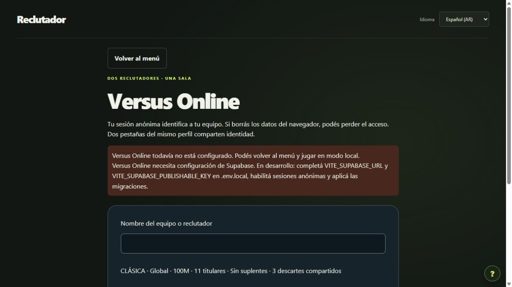

# CODEX-006B — Salas, invitaciones y lobby

Fecha: 2026-10-18. Estado: parcial; implementación y pruebas locales, E2E Supabase pendiente. A quedó estable localmente en `663cd60`; se continúa con adaptadores según la excepción expresa del encargo cuando falta un proyecto real.

## Entregado

- Entrada VERSUS ONLINE junto al duelo local y Draft Libre. No altera el motor local, CPU, modalidades ni datos deportivos. Carga diferida del SDK online.
- Crear/unirse con nombre, invitación opaca de 64 hexadecimales generada en servidor (dos UUID v4 independientes; 244 bits de entropía), enlace copiable y entrada por `?online=...` o código. Los UUID de sala no permiten unirse. Identidad y nombre independientes.
- Configuración exclusivamente clásica: Global, 100M, once titulares, cero suplentes y tres descartes compartidos, validada también en SQL. Sala con vencimiento por defecto a 24 horas. El administrador puede modificar el DEFAULT de `rooms.expires_at` para futuras salas; no existe parámetro cliente para cambiarlo.
- Lobby con anfitrión/invitado, disponibilidad, listos, configuración, vencimiento, conexión propia y salida. No afirma presencia del rival: sin Presence ni latidos verificados, conectado describe solo el canal propio.
- Crear, unir, listo, salida e inicio son RPC autenticados, con bloqueos, ledger e idempotencia. La versión esperada rechaza acciones obsoletas. Los reintentos por error de transporte conservan actionId, payload y versión. Reusar ID con otros datos se rechaza. La creación usa bloqueo transaccional por identidad/acción; las mutaciones bloquean la sala. Un comando rechazado no cambia estado ni escribe una acción aprobada.
- Anfitrión inicia solo con ambos listos: READY → IN_PROGRESS/COIN_TOSS. Es un límite visible: no hay moneda resuelta, pujas, adjudicaciones ni simulación online. No se usa el estado local como fuente competitiva. C permanece no iniciada.
- Invitado que sale pierde membresía, libera su lugar y reinicia los listos; anfitrión que sale cancela la sala para ambos. El doble envío de salida no repite el efecto. No se habilita salir mediante comando de lobby después del inicio, pero volver al menú conserva la recuperación de esa sala.
- Realtime privado recibe exclusivamente invalidaciones (roomId/version) originadas en SQL. RLS autoriza por pertenencia; no hay INSERT de cliente. Un socket previamente autorizado podría recibir invalidaciones tras perder membresía: nunca contienen nombres, invitaciones, semilla ni estrategias, y el snapshot vuelve a comprobar pertenencia.
- Reconexión: SDK conserva sesión, se verifica pertenencia por snapshot, se suscribe y vuelve a obtener snapshot al confirmar la suscripción. Cada aviso recupera estado completo, por lo que tolera saltos de versión. Recuperación adicional cada 10 segundos y al recuperar foco/red/visibilidad; nunca decide acciones competitivas. Respuestas antiguas no rebajan la versión mostrada. Metadata local de recuperación solo guarda roomId/userId y tolera almacenamiento bloqueado.
- Textos, errores, controles accesibles y avisos en es-AR/en/pt-BR. En producción el aviso de configuración es de producto; instrucciones de variables solo en desarrollo.

## Migraciones y pruebas reales

`202610180001_online_foundation.sql` y `202610180002_online_lobby.sql`: ambas aplicadas en PostgreSQL embebido. **Cero migraciones aplicadas a Supabase remoto.** El shim de plataforma proporciona auth.uid y realtime.send/topic; no simula las reglas de sala, que se ejecutan como SQL/PLpgSQL con roles, RLS y permisos reales. La integración de JWT/WebSocket/servicio Realtime sigue sin comprobarse.

15 pruebas SQL: las cinco de A más diez de RPC/permisos del lobby. Cubren creación y unión repetidas, identidad compartida que no ocupa dos lugares, tercero rechazado, snapshot ajeno prohibido, nombres/payloads adulterados, versión obsoleta, ambos listos, inicio restringido, recuperación de miembros tras inicio, salidas y cancelación, expiración, invalidaciones sin secretos, canal ajeno rechazado y envío cliente prohibido. No se afirma haber ejecutado transacciones concurrentes en dos conexiones PostgreSQL: PGlite serializa llamadas; la prueba de versión obsoleta no sustituye una prueba de carrera remota.

10 pruebas DOM con adaptador explícito: configuración ausente, creación en tres idiomas, actualización del rival y salto de versión, limpieza de suscripción, recuperación por dueño, bloqueo de creación durante recuperación, invitación en URL, reintento de comando exacto y salida. 5 pruebas del transporte oficial: identidad deduplicada por cliente, dos clientes independientes, sesión conservada, actor manipulado no serializado, canal privado autenticado con resync/limpieza y configuración económica no admitida rechazada (algunos escenarios se agrupan en una prueba). Más tres contratos y regresión completa de idiomas/modo local.

Navegador real: Vite dentro del sandbox no fue accesible (ERR_CONNECTION_TIMED_OUT). Vite fuera del sandbox en 127.0.0.1:5180 sí permitió verificar menú, entrada online y aviso sin configuración, además del cambio de los tres idiomas. Revisión de escritorio y tamaños 390/360: ancho de documento 375/345 respectivamente, menor al viewport; sin desborde horizontal. Captura completa vía API falló, la captura normal sí funcionó. No se revisó visualmente un lobby con dos miembros porque no existe backend configurado; DOM con adaptadores no sustituye esa revisión. Evidencia:

Resultados finales: `npm run typecheck`, `npm run lint`, `npm test` y `npm run build` aprobados. **676/676 pruebas en 45 archivos**, incluidas 33 online (3 contratos, 15 SQL, 10 DOM y 5 transporte); las 643 anteriores se mantienen. Build genera chunk online diferido (~225 kB sin comprimir), PGlite no integra el bundle de producción. Continúa el aviso histórico del chunk principal mayor a 500 kB (~807 kB), sin impedir el build. `git diff --check` correcto. No se repitieron calibraciones deportivas ni auditoría de los 350 futbolistas; la suite preexistente ejecutó sus regresiones habituales y regeneró un informe histórico de estrés, restaurado exactamente antes del commit.

Commit local independiente para B, sin push/deploy. Estado final previsto/verificado tras guardar: únicamente `.claude/` ajeno sin versionar, como al inicio. Los servidores Vite iniciados para esta revisión fueron detenidos; no se alteraron servidores preexistentes.

## Configuración externa y aceptación pendiente

1. Elegir un proyecto Supabase propio/autorizado (no se creó ni se conectó ninguno). Habilitar Anonymous Sign-Ins en Auth. Revisar controles de abuso del proveedor; no se incorporan servicios pagos.
2. Aplicar primero `supabase/migrations/202610180001_online_foundation.sql`, después `202610180002_online_lobby.sql`, usando el editor SQL del proyecto autorizado o CLI con historial de migraciones. Para pruebas locales con CLI: `npx supabase init`, habilitar `auth.enable_anonymous_sign_ins` en config.toml, `npx supabase start` y `npx supabase db reset` (requiere Docker y solo sobre base de pruebas descartable). Estos comandos no se ejecutaron en esta entrega.
3. Deshabilitar **Allow public access** en ajustes Realtime. Revisar que no existan políticas previas permisivas que amplíen acceso a realtime.messages. Las tablas de juego no necesitan añadirse a una publicación Postgres Changes: se usa `realtime.send` desde trigger.
4. `Copy-Item .env.example .env.local`, completar solo URL y clave pública **sb_publishable_...** y reiniciar `npm run dev`. Este adaptador exige la clave publishable moderna; rechaza claves secretas y JWT legados. No pegar contraseñas, claves secret o service-role en este repositorio/chat ni desactivar RLS.
5. Abrir perfiles de navegador independientes A y B (las dos pestañas de un perfil comparten Auth). Crear en A, ingresar en B, observar ambos nombres/configuración y ambos listos, iniciar desde anfitrión y comprobar estado idéntico. Tercera identidad C: unión rechazada y lectura de UUID ajeno sin resultados / RPC NOT_ROOM_MEMBER. Intentar escrituras directas, envío de actor ajeno y canal ajeno: deben rechazarse. Desconectar/reconectar B, mantener mismo UID, estado y versión. Probar competencia simultánea por segundo slot y acciones con la misma versión en dos conexiones.

**Dos navegadores con identidades reales y backend configurado: NO EJECUTADO.** Auth remoto, JWT, RLS alojado, canales privados y concurrencia remota: pendientes. No se declara que funciona el multijugador real. Próximo paso: aplicar ambas migraciones en entorno autorizado y completar esa matriz; recién entonces considerar CODEX-006C.
